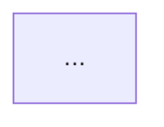

# Report Template

Use this structure for the executive summary produced by
`rec_generate_report`. Keep all content ASCII and use standard Markdown.

## File Set

| File | Purpose |
| --- | --- |
| `01_Executive_Summary.md` | Decision-oriented narrative and tables. |
| `02_Full_Recon_Data.json` | Machine-readable campaign data. |
| `03_Entity_Relationship_Map.md` | Mermaid graph and ASCII tree. |

## Executive Summary Structure

### Title

```markdown
# Executive Summary: <Campaign Name>
```

### Assessment Snapshot

Include a two-column table with:

- Campaign name.
- Generation timestamp in UTC.
- Tool name and version.
- Number of assessment runs.
- Targets.
- Modes.
- Stealth runs versus total runs.
- Strict OSINT runs versus total runs.
- Graph entity and relationship counts.
- Highest CVSS and risk label.

Risk labels:

| Highest CVSS | Label |
| --- | --- |
| 9.0 or higher | Critical |
| 7.0 to 8.9 | High |
| 0.1 to 6.9 | Moderate |
| 0.0 or no findings | Informational |

### Scope And OPSEC

State:

- What was authorized.
- Which modes and modules executed.
- That reconnaissance was passive or non-exploitative.
- Any active steps taken and the authorization for them.
- Any platform or source limitations encountered.

### Attack Surface

Provide a metrics table:

- Observed hosts.
- Archived URLs from the Wayback Machine.
- Discovered vulnerabilities.
- JavaScript endpoints.
- Potential secrets.
- Identity email candidates.
- Social profiles.
- Username matches from public profile checks.
- Strict-filtered matches.
- Breach exposure records.
- Public repositories.
- Public documents.

Then provide a host inventory table:

| Host | IP | CDN/WAF | Ports | Technologies |
| --- | --- | --- | --- | --- |

Use `unresolved` when no IP was recorded and `none` when no CDN or technology
was observed.

### Wayback Machine Snapshots

Provide a table of archived URLs recovered from the public CDX index:

| Host | Original URL | Captured (UTC) | Snapshot link | Status | Type |
| --- | --- | --- | --- | --- | --- |

State that the links replay archived copies and that the target was not
requested during the lookup. Do not treat an archived page as current evidence.

### High-Value Entities

List prioritized entities with a reason:

| Type | Entity | Notes |
| --- | --- | --- |

Include vulnerabilities, people, social accounts, repositories, and unusual
infrastructure. Do not include every domain or port.

### Vulnerability Mapping

Use:

| CVE | CVSS | Component | Summary |
| --- | --- | --- | --- |

Add this note after the table:

```text
These mappings are passive associations between observed product versions and
public CVE metadata. Exposure and exploitability require validation.
```

If no mappings exist, state that missing versions or API limits may reduce
coverage.

### Personnel And Code Exposure

Separate the subsections:

1. Social profiles and username matches.
2. Breach exposure.
3. Public repositories and commit emails.
4. Public documents and metadata.

Use this table for breach exposure:

| Identifier | Provider | Breach | Date | Data classes |
| --- | --- | --- | --- | --- |

State that breach findings come from official provider APIs and that leaked
records, passwords, and hashes were not retrieved or displayed. Name the
providers that were configured, skipped, or errored.

For each subsection, state whether the evidence was verified, inferred, or
unavailable. Do not reproduce full secrets or private contact details.

### Pivot Recommendations

Use:

| Source | Pivot | Target | Reason |
| --- | --- | --- | --- |

Include only pivots supported by the rules in `pivoting_rules.md`. List
unexplored graph pivot points separately as bullets.

### Operational Observations

Call out:

- Hosts without CDN or WAF attribution.
- Non-production or sensitive naming patterns.
- Certificate names absent from passive DNS.
- Unusual ports or administrative services.
- Identity-rich assets worth deeper review.

When none apply, state that no obvious anomalies were observed.

### Recommended Next Steps

Provide concrete actions, ordered by risk reduction. Examples:

1. Validate high-CVSS findings against the affected component and exposure path.
2. Prioritize identity-rich assets for deeper OSINT and repository review.
3. Enumerate JavaScript-derived internal hosts not present in passive DNS.
4. Review Wayback snapshots for removed paths, legacy services, and older software.
5. Review confirmed breach exposure for credential-reuse risk and coordinate password rotation outside this tool.
6. Review public repository indicators for unlisted services and versions.
7. Confirm scope and authorization before any active validation.

### Limitations

Always include:

- CVE mapping is version-based and does not prove exploitability.
- Passive DNS and certificate sources may be incomplete or delayed.
- Wayback Machine coverage depends on archive.org crawls; snapshot links replay
  archived copies, not live services.
- Social platform responses may be blocked, rate limited, or unverified.
- Username matches are public-profile signals, not proof of identity.
- Strict OSINT mode reduces false positives but may suppress true matches when
  a profile relies on JavaScript rendering, hides the identifier, or blocks
  automated verification.
- Breach metadata depends on provider API keys and coverage; leaked records,
  passwords, and hashes are not retrieved.
- Document and JavaScript analysis is limited to public content.
- Identity matches require human verification.

## Relationship Map Structure

````markdown
# Entity Relationship Map: <Campaign Name>

Generated: <UTC timestamp>

Entities: <n> | Relationships: <n>

## Mermaid Entity Graph



## ASCII Relationship Tree

```text
...
```

## Legend

- ORG: ...
- ASN: ...
````

The Mermaid block must start with `graph LR`. The ASCII tree must use only
`|--`, `` `-- ``, and spaces for indentation.

## Writing Rules

- Lead with impact and evidence, not tool mechanics.
- State confidence for identity matches: confirmed, probable, possible, or
  unverified.
- Use "observed", "inferred", and "hypothesized" precisely.
- Avoid marketing language, superlatives, and alarmist wording.
- Do not claim compromise, exploitation, or unauthorized access.
- Redact live credentials and personal contact details in prose while keeping
  stable identifiers in tables and JSON.
- Keep table cells short. Move detail into JSON.
- Use ASCII hyphens, not typographic dashes.
- Do not use emojis, icons, or decorative Unicode symbols.

## Consistency Checks

Before delivery, confirm:

1. Run count and host count match the consolidated JSON.
2. Graph node and edge counts match the relationship map.
3. The highest CVSS value matches the vulnerability table and risk label.
4. Every social profile, repository, and document count matches its table.
5. The username match and breach exposure counts match their tables.
6. The strict-filtered count matches the sum of `strict_filtered` across runs.
7. The archived URL count and replay links match the Wayback table.
8. Every pivot recommendation has a source and reason.
9. All three files exist, are non-empty, and contain only ASCII.
10. The report does not contain placeholder text such as `TBD` or `TODO`.
